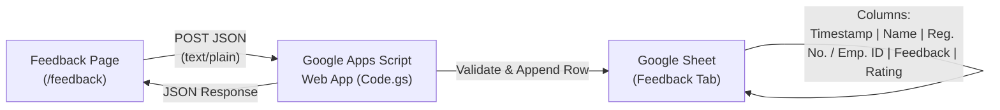

# Google Sheets Feedback Setup Guide — Workplace Harassment G8

This guide explains step-by-step how to set up the Google Sheets storage backend using Google Apps Script for the Workplace Harassment presentation website.

> [!NOTE]
> No special Google Cloud paid account, developer credentials, or API keys are required. You only need a standard, free Google account.

---

## Architecture Overview



---

## Step 1: Create the Google Sheet

1. Open your browser and go to [Google Sheets](https://sheets.new).
2. Name the spreadsheet:
   `Workplace Harassment G8 — Feedback`
3. Name the active tab at the bottom:
   `Feedback`
   *(Optional: You can leave it as "Sheet1"; the script will automatically recognize or configure it).*
4. You do not need to manually type column headers — the script will automatically create formatted headers with dark graphite and golden accents when initialized.

---

## Step 2: Open Google Apps Script

1. Inside your new Google Sheet, click the top menu:
   **Extensions** ➔ **Apps Script**.
2. A new tab will open with the Google Apps Script code editor.
3. In the top-left corner of the Apps Script editor, rename the project from "Untitled project" to:
   `Workplace Harassment Feedback API`

---

## Step 3: Add the Backend Code

1. In the Apps Script code editor, locate the file named `Code.gs`.
2. Delete any existing template code inside `Code.gs`.
3. Open the file [backend/google-apps-script/Code.gs](../backend/google-apps-script/Code.gs) from this repository.
4. Copy the entire contents of `Code.gs` and paste it into the editor.
5. Click the **Save** icon (diskette icon) or press `Ctrl + S` (`Cmd + S` on Mac).

---

## Step 4: Test Permissions (One-Time Authorization)

Before deploying, test that Google allows the script to access your sheet:

1. In the toolbar at the top of the Apps Script editor, select the function `testSetup` from the function dropdown.
2. Click **Run**.
3. Google will show an **"Authorization required"** popup. Click **Review permissions**.
4. Select your Google account.
5. You may see a warning screen saying *"Google hasn't verified this app"*.
   - Click **Advanced** (bottom left).
   - Click **"Go to Workplace Harassment Feedback API (unsafe)"**.
   - Click **Allow**.
   *(This is standard for personal Apps Scripts you write for yourself).*
6. Look at the **Execution log** at the bottom. It should say:
   `Sheet connection verified! Sheet name: Feedback`.
7. Switch back to your Google Sheet tab. You will see the styled header row:
   `Timestamp | Name | Reg. No. / Emp. ID | Feedback | Rating`

---

## Step 5: Deploy as a Web App

To allow the public website to submit feedback to this script:

1. In the top-right corner of the Apps Script editor, click the blue **Deploy** button ➔ **New deployment**.
2. Click the gear icon next to "Select type" and choose **Web app**.
3. Fill in the deployment settings:
   - **Description**: `Workplace Harassment Feedback v1`
   - **Execute as**: **Me (your-email@gmail.com)** *(Important: Allows the script to write to your sheet on behalf of anonymous visitors without requiring them to sign in)*
   - **Who has access**: **Anyone** *(Important: Allows attendees scanning the QR code to submit feedback without requiring a Google sign-in)*
4. Click **Deploy**.
5. Copy the **Web App URL**. It will look like:
   `https://script.google.com/macros/s/AKfycb.../exec`

> [!WARNING]
> Do NOT select "Anyone with Google account" or "Only myself", as this will prevent attendees from submitting feedback unless they authenticate with Google first.
> Keep the URL ending in `/exec` (do NOT use `/dev`).

---

## Step 6: Security Implications & Why This is Safe

1. **Why "Execute as: Me"?**
   The script acts as a secure proxy. The public visitor never has direct access to your Google account or Google Drive. They can only execute the specific code in `Code.gs`.
2. **Data Isolation:**
   The script only modifies the specific Google Sheet linked to it. It has no permission to read or touch any other documents or emails in your Google account.
3. **Spam & Flooding Protection:**
   - Honeypot field: Automated spam bots filling hidden inputs are dropped immediately.
   - Server-side validation: Submissions are checked for length, required fields, and valid star ratings (1-5).
   - Short-term anti-flood caching: Identical rapid double-submissions are suppressed.

---

## Step 7: Configure the Website Endpoint

1. In the root directory of this repository, copy `.env.example` to `.env`:
   ```bash
   cp .env.example .env
   ```
2. Open `.env` and set `VITE_FEEDBACK_ENDPOINT` to your Web App URL:
   ```env
   VITE_FEEDBACK_ENDPOINT=https://script.google.com/macros/s/AKfycb.../exec
   VITE_SITE_URL=https://workplace-harassment-universe.pages.dev
   ```
3. Restart your Vite development server if it was running:
   ```bash
   npm run dev
   ```

---

## Step 8: Verify and Test a Submission

### Method A: Direct Browser Verification
Paste your Web App URL (`https://script.google.com/macros/s/.../exec`) into any browser tab.
You should see a JSON response:
```json
{
  "status": "ok",
  "service": "Workplace Harassment G8 - Feedback API",
  "version": "1.0.0",
  "message": "The feedback endpoint is active and ready to receive POST submissions."
}
```

### Method B: Test from the Website
1. Open your browser to `http://localhost:5173/feedback` (or click **Feedback** in the website header).
2. Enter a test name: `Test Student`.
3. Enter an optional ID: `2024-TEST-001`.
4. Select 5 stars.
5. Enter a feedback review: `Great 3D visualization and clear explanation of the POSH Act!`.
6. Click **Submit Feedback**.
7. You will see the animated success screen.
8. Switch to your Google Sheet — a new row with the timestamp, name, Reg. No. / Emp. ID, feedback, and rating will appear instantly!
